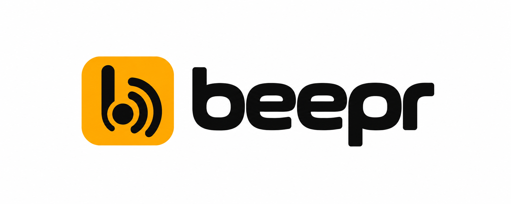

<p align="center">
  <a href="https://techmefr.github.io/beepr/"></a>
</p>

# beepr

**One signal. Every listener.**

A tiny, typed event/notify engine. One handler contract, composable adapters,
zero framework lock-in. Built on [`hookable`](https://github.com/unjs/hookable).

> **Keywords** — `events` · `event-bus` · `notifications` · `pubsub` · `typescript` · `typed-events` · `hooks` · `hookable` · `adapters` · `framework-agnostic`

## Install

```bash
pnpm add beepr
```

## Usage

```ts
import { createNotify, mergeEventHandlers } from 'beepr'
import type { SdkEvent, SdkEventHandler } from 'beepr'

// Turn a typed adapter into a raw (event, data) => void handler
const notify = createNotify({
  onRequest: ctx => console.log('→', ctx.resource),
  onSuccess: data => console.log('ok', data),
  onError:   err => console.error(err.message),
  onConnected:    () => {},
  onDisconnected: () => {},
})

// Combine a global handler with a per-call one (both fire)
const handler = mergeEventHandlers(globalNotify, notify)
handler('success', { id: 1 })
```

Events: `request · success · error · data · connected · disconnected`.

- **`createNotify(adapter)`** → `SdkEventHandler`.
- **`mergeEventHandlers(a, b)`** — call both if both are defined.
- **`createSdkHooks()`** — a `hookable` instance typed with the event map.

Useful on its own as a typed notification bus, or as the event layer for
[`nexdk`](https://www.npmjs.com/package/nexdk).

## Documentation

Full docs, including how to pair `beepr` with `nexdk`, live at
[techmefr.github.io/beepr](https://techmefr.github.io/beepr/).

## Ecosystem

| Project | Role | Documentation |
|---|---|---|
| [neXdk](https://github.com/techmefr/nexdk) | One resource grammar for REST, GraphQL and WebSocket backends. | [Docs](https://techmefr.github.io/nexdk/) |
| [beepr](https://github.com/techmefr/beepr) | Typed events and notification adapters. | [Docs](https://techmefr.github.io/beepr/) |
| [shamock](https://github.com/techmefr/shamock) | Schema-validated mock data, fixtures and offline fallback. | [Docs](https://techmefr.github.io/shamock/) |

Use each library on its own, or compose them in application code. neXdk does not depend on beepr or shamock.

## License

MIT © techmefr
