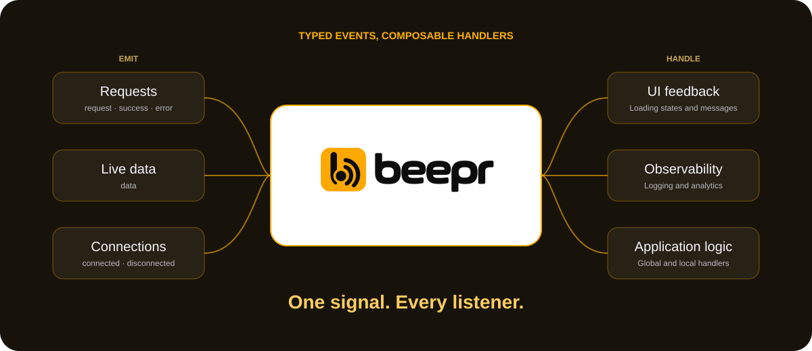

<p align="center">
  <a href="https://techmefr.github.io/beepr/"></a>
</p>

<p align="center">
  <a href="https://github.com/techmefr/beepr/actions/workflows/ci.yml"></a>
  
  <a href="LICENSE"></a>
</p>

<p align="center">
  <a href="https://techmefr.github.io/beepr/"><b>Documentation</b></a> ·
  <a href="https://techmefr.github.io/beepr/getting-started/">Quickstart</a> ·
  <a href="https://techmefr.github.io/beepr/reference/beepr/">API reference</a> ·
  <a href="#ecosystem">Ecosystem</a>
</p>

# beepr

**One signal. Every listener.**

A tiny, typed event/notify engine. One handler contract, composable adapters,
zero framework lock-in, zero dependency.

> **Keywords** — `events` · `event-bus` · `notifications` · `pubsub` · `typescript` · `typed-events` · `adapters` · `framework-agnostic`

## Why beepr

| Feature | What you get |
|---|---|
| **One event contract** | Six typed event names shared by handlers and adapters. |
| **Safe by default** | Every payload is redacted before it reaches an adapter. |
| **Gated debug channel** | Debug output only runs in environments you allow, never in production. |
| **Composable** | Merge handlers; one failing handler never blocks the other. |
| **Independent** | No runtime dependency. Works alone or beside neXdk. |

## Install

beepr is not published to npm yet. Until then, install it from GitHub:

```bash
pnpm add github:techmefr/beepr
```

## Usage

```ts
import { createNotify, mergeEventHandlers } from 'beepr'

const global = createNotify({
  onError: ({ status, kind, resource, method, message }) => console.error(status, kind, resource, method, message),
})
const local = createNotify({
  onSuccess: ({ resource, method, data }) => console.log('ok', resource, method, data),
})

const handler = mergeEventHandlers(global, local)
handler?.('success', { resource: 'users', method: 'get', data: { id: 1 } })
handler?.('error', { message: 'Failed', status: 0, kind: 'timeout', resource: 'users', method: 'get' })
```

Events: `request`, `success`, `error`, `data`, `complete`, `connected`, `disconnected`. With nexdk, `onRequest`, `onSuccess` and `onError` also get `resource` and `method`, and `onError` gets `status` and `kind` (`timeout`, `abort`, `network`, `http`). A non-object payload reaches `onRequest` as `{ payload }` and `onSuccess` as `{ data }`.

**Breaking change** (since the call context commit): `onSuccess` used to receive the raw payload, it now receives a `SuccessContext`. A handler written as `onSuccess: (data) => ...` for a non-nexdk emitter must read `data.data` for a non-object payload.

## Redaction

`createNotify(adapter, options?)` redacts every payload before the adapter sees it.
Adapters get masked copies; your original data is never changed.

```ts
import { createNotify } from 'beepr'

const notify = createNotify({
  onRequest: context => console.log(context),
})

notify('request', { resource: 'login', payload: { email: 'a@b.c', password: 'hunter2' } })
```

```text
{
  resource: 'login',
  payload: { email: 'a@b.c', password: '[redacted]' }
}
```

Options: `redact: false` turns it off, `redactKeys: ['iban']` masks extra keys.
Field names under `errors` of an `error` event are not matched as sensitive keys; messages are still redacted by value.
For standalone use, see `createRedactor`.

## Debug channel

`createDebug` emits `trace`, `state` and `diagnostic` entries to adapters, only when
the current environment is in your allow-list. Production-like names are refused.

```ts
import { createConsoleAdapter, createDebug } from 'beepr'

const debug = createDebug({
  environment: 'development',
  environments: ['development', 'staging'],
  adapters: [createConsoleAdapter()],
})

debug.state('cart', { items: 3, token: 'abc' })
```

```text
[beepr:state] cart { items: 3, token: '[redacted]' }
```

## API

| Export | Role |
|---|---|
| `createNotify(adapter, options?)` | Typed adapter to `SdkEventHandler`, with redaction. |
| `mergeEventHandlers(global, local)` | Run both handlers, isolate failures, rethrow the first error. |
| `resolveEventHandler(local, global)` | The local handler, or one that calls `global.callHook(event, data)`. |
| `createRedactor(extraKeys?)` | Standalone redaction function. |
| `createDebug(options?)` | Environment-gated debug channels. |
| `lazy(resolve)` | Defer expensive debug data until debug is enabled. |
| `createConsoleAdapter()` | Debug-only adapter: prints debug entries, nothing for notify events. |

Full details in the [API reference](https://techmefr.github.io/beepr/reference/beepr/).

## Documentation

Full docs, including how to pair `beepr` with `nexdk`, live at
[techmefr.github.io/beepr](https://techmefr.github.io/beepr/).

## Ecosystem

Each library works on its own. None of them depends on another.

| Project | Role |
|---|---|
| [nexdk](https://github.com/techmefr/nexdk) | One resource grammar for REST, GraphQL and WebSocket backends. |
| [shamock](https://github.com/techmefr/shamock) | Schema-validated mock data, fixtures and offline fallback. |
| [dialectr](https://github.com/techmefr/dialectr) | One query builder that compiles to lomkit, Strapi and PocketBase. |

## License

MIT © techmefr
